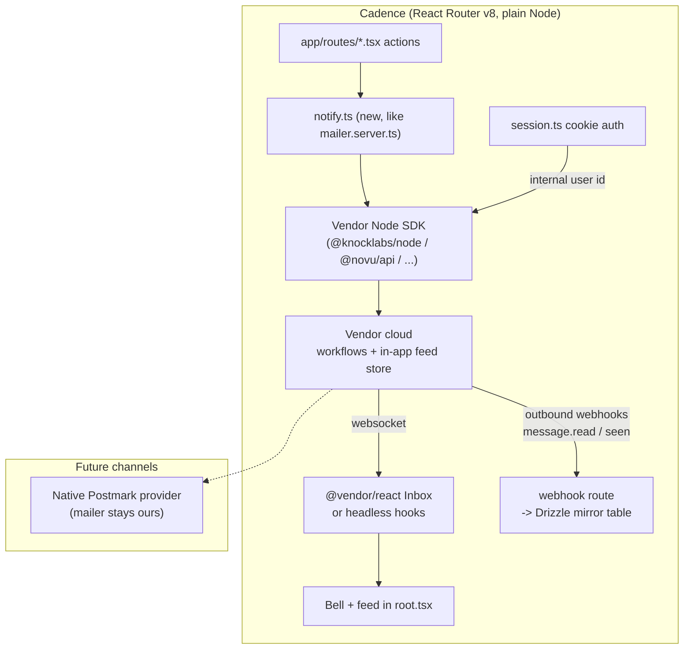

# Vendor bake-off: in-app notification service for Cadence

Researched: 2026-11-13. All claims traced to the vendor's own pricing/docs/GitHub pages (primary sources). Anything I could not verify is marked **[unverified]**.

---

## 1. The question and constraints

**Question:** Does Knock (knock.app) remain the right in-app notification service for Cadence, or does an alternative clearly beat it?

Cadence is a mini-Udemy-style course platform. The feature is **in-app notifications only** (bell icon + feed). Email/push are future channels.

Stack reality:

- React Router v8 (Remix-style loaders/actions), TypeScript, Vite — plain Node server, no edge
- SQLite via better-sqlite3 + Drizzle ORM
- Hand-rolled cookie auth (`app/lib/session.ts`); users identified by our own internal IDs
- Existing email infra: `app/lib/mailer.server.ts` with a `MailTransport` interface, Postmark transport + a dev outbox writing JSON to `.outbox/`

Constraints, in priority order:

1. Free tier, no credit card to evaluate.
2. Node + React friendly: server-side trigger from a React Router app.
3. In-app first, room to grow into email/push later.
4. Must support BOTH headless use (API + our own UI) AND a pre-built React inbox component.
5. Read-state (unread counts, mark-as-read), per-user preferences/muting, realtime (or polling) updates.

---

## 2. Comparison table

| Criterion | **Knock** | **Novu** | **MagicBell** | **Courier** | **SuprSend** |
|---|---|---|---|---|---|
| Free tier | $0, 10k messages/mo, 500 guide recipients, no CC | $0, 10k workflow runs/mo, all channels, 5 workflows, no CC | $0, **1,000 deliveries/mo**, unlimited users, CC unclear | $0, 10k sends/mo, no CC | $0, 10k notifications/mo, no CC |
| Node server SDK | `@knocklabs/node` | `@novu/api` | `magicbell-js` (project client) | `@trycourier/courier` | `@suprsend/node-sdk` |
| Pre-built React inbox | Yes (`@knocklabs/react`) | Yes (`@novu/react`) | Yes (`@magicbell/react`) | Yes (`@trycourier/courier-react`) | Yes (`@suprsend/react`) |
| Headless mode | Yes (hooks) | Yes (headless mode docs + render-prop components) | Yes (`@magicbell/react-headless`) | Yes (`useCourier` data/actions) | Yes (headless feed docs) |
| Read state | Vendor-owned; seen AND read distinction; unread/unseen counts | Vendor-owned; seen/read; badge counts | Vendor-owned; read/seen/archive | Vendor-owned; read/opened/archived | Vendor-owned; read/seen/archived |
| Webhooks for syncing read state to our DB | Yes — `message.seen/read/unread/archived/interacted` | Yes — `message.seen/read/unread/archived` + `preference.updated` | Not documented (no outbound webhooks found) | Not verified | Yes — status events incl. "seen" |
| Per-user preferences | Yes (preference center in kit) | Yes (in-inbox preferences + API) | Yes (`UserPreferences` component) | Hosted preference center | Yes, but **Business plan feature** |
| Realtime | Websockets (SDK-managed) | Websockets (`socketUrl`, `wss://`) | Websockets | Websockets (`wss://realtime.courier.io`) | Sockets (`initializeSocketConnection`) |
| Future channels: email/push | Yes; **native Postmark + generic SMTP** | Yes; **native Postmark** | Yes; SMTP integration, no native Postmark found | Yes; **native Postmark** | Yes; **native Postmark** |
| Sandbox / dev mode | Yes — dev/production environments with isolated data and keys; `sandbox_mode` on trigger | Yes — Dev + Prod environments (2 on free) | Not documented | Test environment per workspace | One-month sandbox trial of paid features |
| Self-host option | No | Yes (community edition; inbox included, gaps noted) | No | No | No |

---

## 3. Per-vendor findings

### 3.1 Knock (knock.app)

**Free tier** — Free plan: $0, up to 10,000 messages/month ("delivered to a single user on a single channel"), 500 guide recipients/month, no credit card ("Start building for free, no credit card required"), unlimited workflows, team members, and Knock branding shown on the free plan. Starter is $250/month. No hard caps on free; Knock contacts you instead. Source: https://knock.app/pricing

**Trigger API** — Node SDK `@knocklabs/node` (official repo [knocklabs/knock-node](https://github.com/knocklabs/knock-node), Apache-2.0): `client.workflows.trigger('key', { recipients: [...], data: {...} })`. REST trigger API takes `key`, `recipients`, `data` (10 MB), optional `cancellation_key`, `tenant`, and an `Idempotency-Key` header for safe retries (24 h). Sources: https://docs.knock.app/send-notifications/triggering-workflows/api and https://github.com/knocklabs/knock-node

**React integration** — `@knocklabs/react` ships pre-built `NotificationFeedPopover`, `NotificationFeed`, `NotificationIconButton` (bell with unread/unseen count), and Slack/Teams kits; the SDK "can be used in a headless way and bring your own UI" with "a complete set of React hooks." Identity is set with `KnockProvider` ("authenticate our current user and get access to the Knock JavaScript client"). Sources: https://docs.knock.app/in-app-ui/react/overview and https://docs.knock.app/in-app-ui/react/inbox . A React quick start exists: https://docs.knock.app/getting-started/quick-start/react (not fetched; referenced from docs nav).

**In-app feed features** — Knock distinguishes **seen vs. read**; unread/unseen counts feed the bell badge. Realtime: the in-app real-time service "automatically pushes these updates to your application through the websocket connection", with SDK-managed reconnect and per-tab auto-disconnect options. Sources: https://docs.knock.app/in-app-ui/feeds/socket-behavior and https://docs.knock.app/in-app-ui/api-overview

**Webhooks / read-state sync** — Outbound webhooks include `message.seen`, `message.unseen`, `message.read`, `message.unread`, `message.archived`, `message.interacted` — so Cadence could mirror read state into SQLite if we want it. Source: https://docs.knock.app/developer-tools/outbound-webhooks/event-types

**Future channels** — Email, push, SMS, Slack, Teams supported. Knock has a **native Postmark provider** and a **generic SMTP provider** — both match our existing mailer. Sources: https://docs.knock.app/integrations/email/postmark and https://docs.knock.app/integrations/email/smtp

**Stack-fit notes**

- Sandbox: every account can enable a **development environment** with fully isolated data and its own API key/secret pair — clean fit for our dev-outbox habit of never touching production data. Source: https://docs.knock.app/version-control/environments
- Trigger API `settings.sandbox_mode: true` generates messages "but not delivered to the underlying providers" — a direct analog of our `.outbox/` pattern. Source: https://docs.knock.app/send-notifications/triggering-workflows/api
- Idempotency header, per-environment keys, and webhook signing all point at a plain-Node server integration with no edge constraints.

### 3.2 Novu (novu.co)

**Free tier** — Free plan: $0, no credit card, 10,000 workflow runs/month, **all channels** (email, in-app, SMS, chat, push), US + EU data residency, 2 environments (Dev + Prod), 3 team members, unlimited subscribers. Pro from $30/month. Self-hosted on-prem is listed as an Enterprise-tier option on the pricing page, but a **community self-hosted edition** is documented and downloadable separately (see below). Source: https://novu.co/pricing

**Trigger API** — Node SDK `@novu/api` (the old `@novu/node` is superseded): `novu.trigger({ workflowId, to: { subscriberId, ... }, payload })`. Supports US cloud, EU cloud, or a self-hosted `serverURL`. Runs on Node, Bun, Deno, Cloudflare Workers. Source: https://docs.novu.co/platform/sdks/server/typescript

**React integration** — `@novu/react` ships a full `Inbox` component (bell, notifications list, preferences inside the inbox menu, heavy theming via `appearance`) plus lower-level `InboxContent`, `Notifications`, `Bell` components with render props, and a documented **headless mode**. Novu publishes a **Remix quick start** — install `@novu/react`, render `<Inbox applicationIdentifier=... subscriberId="...">` in the layout; `subscriberId` is "typically the user's id in your database", which maps one-to-one onto Cadence's internal IDs. Sources: https://docs.novu.co/platform/sdks/react and https://docs.novu.co/platform/quickstart/remix and https://docs.novu.co/platform/inbox/headless-mode

**In-app feed features** — Read state is vendor-owned (seen/read/archived flags; badge counts); realtime via websocket (`socketUrl: "wss://eu.socket.novu.co"` in the setup docs). Preferences UI is built into the Inbox menu. Sources: https://docs.novu.co/platform/inbox/setup-inbox and https://docs.novu.co/platform/sdks/react

**Webhooks / read-state sync** — Webhook events include `message.seen`, `message.read`, `message.unread`, `message.archived`, `message.unarchived`, plus `preference.updated` — enough to mirror state into SQLite. Source: https://docs.novu.co/platform/developer/webhooks/event-types

**Future channels** — Email, SMS, push, chat, in-app. **Native Postmark provider** documented. Source: https://docs.novu.co/platform/integrations/email/postmark

**Self-host story (unique to Novu)** — Community self-hosted edition requires MongoDB (M20+), two Redis clusters (8 GB each), and 10 GB object storage — heavyweight next to SQLite, so self-hosting is not actually attractive for Cadence, but its existence is leverage in pricing and a fallback if the cloud product changes. Inbox components (Bell, Inbox, Notifications, preferences component) **are included** in self-host; snooze and branding removal are cloud-only. Sources: https://docs.novu.co/community/self-hosting-novu/overview and https://docs.novu.co/community/self-hosted-and-novu-cloud . License of the community edition: **[unverified]** — not stated on the docs pages I read.

### 3.3 MagicBell (magicbell.com)

**Free tier** — Builder plan: $0, **1,000 deliveries/month**, 1 project, unlimited team members and users, all integrations. Startup $249/month for 50,000 deliveries. Deliveries count per notification per channel, so one in-app send to one user = 1 delivery. Whether a credit card is required is **not stated on the pricing page [unverified]**. Source: https://www.magicbell.com/pricing

**Trigger API** — Node package `magicbell-js` with a server-side project client (`new Client({ token })`); REST v2 API underneath (JWT auth: project JWT for server, user JWT for users). Notifications are created via `client.broadcasts.createBroadcast(...)` (one-to-many) or `client.workflows.createWorkflowRun(...)` (a defined workflow). Source: https://www.magicbell.com/docs/libraries/magicbell-js

**React integration** — `@magicbell/react` ships `Inbox` (imported from `@magicbell/react/inbox`), `FloatingInbox`, `UserPreferences`, toasts, and theming via CSS variables. Auth is via a `ContextProvider` taking a **User JWT generated on your own server**. A separate official headless package `@magicbell/react-headless` exists in the magicbell-js monorepo for building custom UI. Sources: https://www.magicbell.com/docs/libraries/magicbell-react and https://github.com/magicbell/magicbell-js

**In-app feed features** — Realtime: "Notifications update live via WebSockets. No polling, no custom infra required." Read/unread states, pagination, archive are in the Inbox component. Source: https://www.magicbell.com/inbox

**Webhooks / read-state sync** — I could **not** find outbound webhook documentation in MagicBell's docs: the Integrations page describes only *incoming* webhooks (GitHub, Stripe) and the API reference has an Events *query* API but no outbound-push section. **[unverified / likely gap]** Source: https://www.magicbell.com/docs/integrations and https://www.magicbell.com/docs/api/reference

**Future channels** — Email providers listed: SES, Mailgun, SendGrid, SMTP (plus APNs/FCM push). **No native Postmark integration found** — we would go through generic SMTP, which loses delivery-webhook fidelity vs. the native Postmark transports elsewhere. Source: https://www.magicbell.com/docs/integrations

**Fit notes** — Smallest free tier of the five (1,000 deliveries/mo). No documented dev/sandbox environment. JWT auth is a clean fit with hand-rolled session auth (we mint the JWT from our session). Weakest on read-state sync to our DB.

### 3.4 Courier (courier.com)

**Free tier** — Developer plan: free, 10,000 sends/month, no credit card ("Add a credit card to move to Courier's Business plan"). A "send" is one template to one recipient **across any number of channels** — multi-channel doesn't multiply cost, which is generous for the future-email case. Business is $0.005/send. Source: https://www.courier.com/pricing/

**Trigger API** — Node SDK `@trycourier/courier` (Node 20+): `client.send.message({ message: { to: { user_id: 'user_123' }, template: 'nt_...', data: {...} } })`. Source: https://www.courier.com/docs/sdk-libraries/node

**React integration** — `@trycourier/courier-react` ships `CourierInbox` and `CourierInboxPopupMenu` (plus Vue/Angular/Web Components/mobile SDKs). Headless: `useCourier()` exposes `inbox.feeds`, `inbox.totalUnreadCount`, `readMessage`/`unreadMessage`, `readAllMessages`, pagination — "you can build the whole UI while the SDK keeps everything synced." Realtime via `wss://realtime.courier.io`. Identity: `signIn({ userId, jwt })` where the JWT is generated by your backend with your Courier API key. Sources: https://www.courier.com/docs/in-app/add-an-inbox and https://www.courier.com/docs/in-app/build-a-custom-inbox

**In-app feed features** — Read/opened/archived flags, unread count in the SDK, websocket realtime. Preferences via a **hosted** preference center (iframe-embeddable) rather than an in-app React component, per the inbox docs. Source: https://www.courier.com/docs/in-app/add-an-inbox

**Webhooks / read-state sync** — Not verified; I did not find a read-state webhook list during this pass. **[unverified]**

**Future channels** — Email, SMS, push, in-app, Slack/Teams, chat. **Native Postmark provider** documented. Source: https://www.courier.com/docs/integrations/email/postmark

**Fit notes** — Solid, but Courier's center of gravity is multi-channel orchestration (Journeys, Broadcasts, brands, brand parking for email) rather than in-app-first; the hosted preference center is less "own your UI" than Knock/Novu/SuprSend.

### 3.5 SuprSend (suprsend.com)

**Free tier** — Free plan: $0, "No Credit Card required", 10,000 notifications/month, unlimited channels, unlimited team members, in-app feed **with SuprSend branding**. Note: **user preferences is a Business-plan feature** ($250/mo) per the pricing page — a real gap for the free tier, since per-user muting is a stated constraint. Source: https://www.suprsend.com/pricing

**Trigger API** — Node SDK `@suprsend/node-sdk`: `supr_client.workflows.trigger(new WorkflowTriggerRequest({ workflow, recipients: [{ distinct_id, ... }], data }, { idempotency_key }))`. Users identified by `distinct_id`; `$skip_create` prevents auto-creating unknown users (nice fit with our internal IDs). Source: https://docs.suprsend.com/docs/trigger-workflow

**React integration** — `@suprsend/react` (the old `@suprsend/react-inbox` is end-of-support): two documented paths — drop-in components, or **headless implementation**. Inbox auth upgraded "from HMAC subscriber_id to signed JWT user tokens" — again, we mint the JWT from our own session. Sources: https://docs.suprsend.com/docs/react-inbox-integration and https://docs.suprsend.com/docs/react-sdk

**In-app feed features** — Headless JS feed client: `fetch()`/`fetchNextPage()`, `markAsRead`/`markAsSeen`/`markAllAsRead`, badge count with `resetBadgeCount()`, realtime via `feedClient.initializeSocketConnection()` with `feed.store_update` and `feed.new_notification` events. Source: https://docs.suprsend.com/docs/js-inapp-feed

**Preferences** — Rich: sections/subcategories, per-category opt-in/out, per-channel overrides, channel-level muting (`ALL` vs `REQUIRED`), `is_editable` flags — but gated to Business plan per pricing. Source: https://docs.suprsend.com/docs/preference-react-sdk

**Webhooks / read-state sync** — Outbound webhooks deliver normalized status events ("sent, delivered, seen etc.") per channel, with `idempotency_key`, `supr_nid`, `distinct_id`, and `suprsend_status` in the payload — designed for upserting state into your own DB. Full read/unread event list **[unverified]**. Source: https://docs.suprsend.com/docs/outbound-webhook

**Future channels** — Email, SMS, WhatsApp, push, Slack/Teams, in-app; **native Postmark provider** documented. Source: https://docs.suprsend.com/docs/postmark

**Fit notes** — A genuine in-app-first player with good headless docs and the most explicit webhook-for-syncing story. Loses points on the free-tier preferences gap and branding.

### 3.6 Other players, and the roll-your-own baseline

**Other vendors** — I found no additional in-app-first vendor of consequence beyond the five above. A cross-check of a (secondary, vendor-authored) market list surfaced Stream, Braze, Airship, and OneSignal — none in-app-first: Stream is an activity-feed API with no email/SMS, OneSignal is push-first with "in-app messages as pop-ups only, no stored message history". Source (secondary, SuprSend's own blog — used for discovery only, not for claims about Cadence): https://www.suprsend.com/post/best-in-app-notification-platforms . **"Engagesoft"/"Enage": I found no such vendor in any search; no evidence it exists.**

**Roll-your-own baseline (incumbent)** — Cadence already has everything the hard parts need except the bell: a `notifications` table in SQLite via Drizzle (id, user_id, type, payload JSON, read_at, created_at), a server-side `notify()` function in the same style as `mailer.server.ts`, a React Router resource route for the feed, and an SSE endpoint for realtime (or a 30 s poll). Rough cost: 1–2 days to build, permanent ownership of schema, zero vendor risk, zero monthly cost. What you give up: preferences UI, digest/batching, mobile-push later, and the polish of a pre-built inbox component (though a course-platform bell is not deep UI).

---

## 4. How a vendor slots into Cadence (diagram)

The load-bearing facts: our server SDK call is one function behind our own seam, our internal user IDs flow through unchanged, the React inbox is a client component mounted in `root.tsx`, and Postmark later plugs into the vendor rather than replacing our mailer.

---

## 5. Recommendation

**Recommendation: keep Knock.** Novu is the only vendor that comes close, and nothing clearly beats Knock for this stack. Reasons, in order of weight:

1. **Both integration modes are first-class.** `@knocklabs/react` gives a pre-built bell + popover inbox **and** "a complete set of React hooks" for headless use (https://docs.knock.app/in-app-ui/react/overview). Novu and SuprSend match this; MagicBell and Courier match it too, but MagicBell's free tier (1,000 deliveries) and missing read-state webhooks, and Courier's hosted-preference-center model, make them second-best fits.
2. **Dev-mode matches our dev-outbox habit.** Knock's isolated development environment with its own keys (https://docs.knock.app/version-control/environments) plus `sandbox_mode: true` on the trigger API ("Messages are generated but not delivered") is the direct hosted analog of `.outbox/`. Only Knock documents both.
3. **Read-state sync back to SQLite is documented.** Knock's webhooks emit `message.seen/read/unread/archived/interacted` (https://docs.knock.app/developer-tools/outbound-webhooks/event-types) — MagicBell has no equivalent documentation, which is the deciding tie-breaker if we ever want read state in our own DB.
4. **Free tier is sufficient and card-free**, with 10k messages/month and unlimited workflows (https://knock.app/pricing) — tied with Novu, Courier, and SuprSend; better than MagicBell.
5. **Postmark is already a native provider**, so future email rides the vendor without displacing our mailer (https://docs.knock.app/integrations/email/postmark).

**Why not Novu?** Novu is genuinely strong — cheapest paid tier ($30 vs $250), a Remix-specific quick start (https://docs.novu.co/platform/quickstart/remix), and the only self-host escape hatch. It would be the pick if (a) cost at small scale matters more than polish, or (b) we ever want notifications on our own infrastructure. Against it for Cadence: self-hosting requires MongoDB + 2 Redis clusters (absurd next to SQLite — https://docs.novu.co/community/self-hosting-novu/overview), and Knock's in-app tooling is deeper (seen-vs-read semantics, per-tab socket options, guide product) and more battle-tested for exactly the "inbox with preferences and webhooks" brief.

**Why not roll our own?** It is the incumbent baseline and remains viable — but the constraint list explicitly asks for preferences UI, pre-built inbox, and a growth path to email/push, which is 2–3 extra subsystems we'd own. Use Knock; keep the `notify()` seam so reverting to in-house (or Novu) stays a one-file change.

**What would overturn this recommendation:**

- **Free-tier reality check:** sign up for Knock and confirm no card is demanded and the free plan still shows branding-only limits at 10k messages. If Knock requires a card or has gated environments, Novu's free plan (2 environments included) wins on constraint 1.
- **React Router v8 friction:** if `@knocklabs/react` misbehaves under RRv8/SSR in a spike, Novu's documented Remix quick start becomes the better-supported path.
- **Cost at scale:** if Cadence grows past ~50k messages/month, Knock jumps to $250/mo while Novu's Pro is $30 — that crossover alone justifies revisiting.
- **Preference features on free tiers:** if per-user muting must work at $0, note Knock's free plan includes preferences while SuprSend's does not — but verify Knock's exact feature gating in the dashboard, which I could not fully confirm from public pages.

## 6. Unverified claims

- MagicBell: whether a credit card is required for the Builder plan — not stated on https://www.magicbell.com/pricing
- MagicBell: absence of outbound webhooks — I found no docs for them, but could not prove they don't exist (their EventSource/SNS integration docs were not fetched).
- Courier: webhooks for in-app read-state sync — not verified.
- SuprSend: the complete webhook event list (docs show "sent, delivered, seen"; a read/unread pair is likely but unverified).
- Novu: the license of the community self-hosted edition — not stated on the docs pages fetched.
- Knock: plan limits on environments (how many are free) — not stated on https://docs.knock.app/version-control/environments
- The npm page for `@magicbell/react-headless` returned HTTP 403; verified indirectly via the official monorepo README instead (https://github.com/magicbell/magicbell-js).
